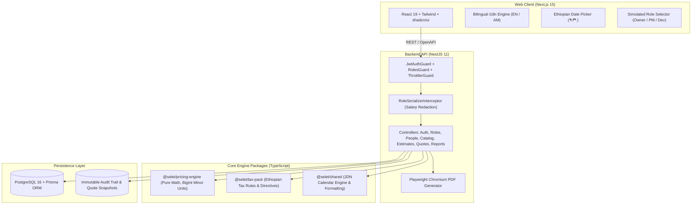

# Selet (ስሌት) Architecture & Technical Specification

**Version:** 1.0.0  
**Repository:** `https://github.com/Afro-Digital/Selet-.git`  
**License:** Apache-2.0  

Selet (ስሌት) is an open-source, self-hosted software estimation, margin balancing, and commercial pricing platform designed specifically for Ethiopian software companies, digital agencies, and independent consultancies.

---

## 1. High-Level System Architecture



---

## 2. Monorepo Organization (Turborepo + pnpm)

```
Selet (ስሌት)/
├── apps/
│   ├── api/                     # NestJS 11 REST API with Swagger/OpenAPI & Playwright PDF
│   └── web/                     # Next.js 15 App Router web application
├── packages/
│   ├── pricing-engine/          # Pure functions, BigInt santim units, margin on price math
│   ├── tax-pack/                # Ethiopian tax proclamation models (VAT 15%, Withholding 3%, POESSA 11%)
│   └── shared/                  # Ethiopian <-> Gregorian calendar conversion, Ge'ez numerals, date formatters
├── scripts/
│   ├── backup.sh                # Timestamped, gzip-compressed Postgres backup with SHA-256
│   └── restore.sh               # Verified database restoration script
├── docs/                        # Architecture, formulas, guides, and legal disclaimers
├── docker-compose.yml           # Production multi-container setup (Postgres + API + Web)
└── pnpm-workspace.yaml          # Monorepo workspace configuration
```

---

## 3. Core Principles & Non-Negotiable Rules

1. **Integer Minor Units Everywhere:** Money is strictly represented as integer minor units (santim or cents) stored as `BigInt` or 64-bit integers. Floats are forbidden for currency storage and arithmetic. Formatting to major units (e.g. `128.50 ETB`) occurs exclusively at presentation edges.
2. **Margin on Price, Never Markup:** Profit margin is strictly computed on selling price: $P = \frac{C}{1 - m}$.
3. **Pure Pricing Engine:** The `@selet/pricing-engine` package contains zero I/O, zero network dependencies, and zero database connections. It consists solely of deterministic pure functions with 100% test coverage.
4. **Strict Role-Based Confidentiality (RBAC):**
   - **Organization Owner:** Complete visibility into team member salaries, overhead rates, commercial floor guards, margin balancing, and portfolio profit reports.
   - **Project Manager (PM):** Estimates, WBS features, risk multipliers, and client deliverable pricing. Individual team member salaries are masked (`hourlyCostMinor` redacted).
   - **Developer:** Task hours estimation, assigned feature deliverables, and calendar deadlines. Sensitive salary figures, pricing margins, scenario models, and executive reports return `403 Forbidden` and are redacted in the UI.
5. **Immutable Quote Snapshots:** Once a quote is issued to a client, its pricing structure, milestone schedule, deliverables, and tax rates are frozen into an immutable JSON snapshot. Future modifications to rate cards or catalog prices do not alter issued quote history.
6. **Canonical UTC Storage with Localized Display:** All dates and timestamps are stored canonically in UTC (ISO 8601) in PostgreSQL. Conversions to the Ethiopian Calendar (ዓ.ም.) and Ge'ez numerals occur only at formatting edges.

---

## 4. Ethiopian Calendar & Date Engine (`@selet/shared`)

The Ethiopian calendar consists of **12 months of 30 days each**, followed by a **13th month (*Pagumē*)** having 5 days in a standard year and 6 days in a leap year.

### 4.1 Julian Day Number (JDN) Algorithm
Selet implements a bidirectional calendar conversion using continuous Julian Day Numbers:
- **Ethiopian Leap Year Rule:** A year is a leap year if `(year % 4 === 3)`.
- **Era Offset:** The Ethiopian era begins 7 years and 8 months after the Gregorian era.
- **Verification:** Verified by unit tests covering 110 consecutive years (1970–2080 G.C. / 1962–2072 E.C.), including leap year transitions and *Pagumē* edge cases.

### 4.2 Ge'ez Numeral Formatter
Numbers are formatted into Ge'ez script using standard modular decomposition:
- Units (፩ to ፱), Tens (፲ to ፺), and Hundreds (፻, ፼).

---

## 5. Security & Hardening Features

- **HTTP Security Headers (Helmet):** X-Frame-Options, X-Content-Type-Options, HSTS, XSS Filter, and permissive CSP for Swagger UI and Playwright PDF rendering.
- **Rate Limiting (`@nestjs/throttler`):** Global rate limiter configured at 150 requests per minute to prevent brute-force attacks on authentication, report queries, and PDF generation endpoints.
- **CORS Configuration:** Configurable origin matching via `CORS_ORIGIN` environment variable.
- **Input Validation:** Global `ValidationPipe` with `whitelist: true, forbidNonWhitelisted: true, transform: true`.
- **Database Backup & Recovery:** Gzip-compressed dumps with automated SHA-256 integrity verification.
